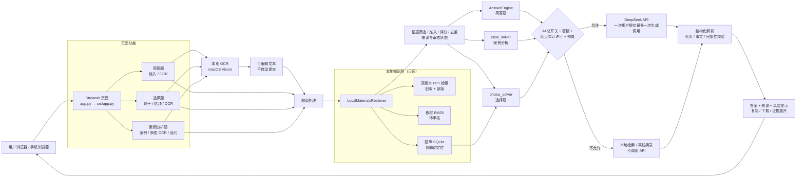
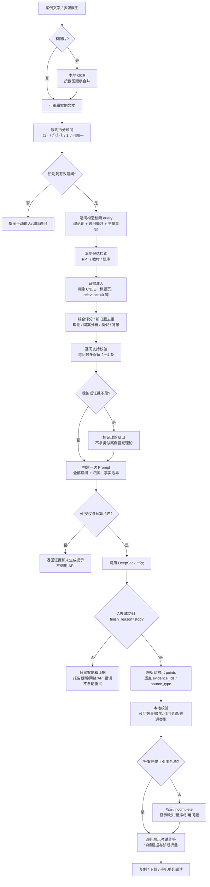

# Engineering-Ethics-RAG

**面向《工程伦理》课程复习的本地资料检索增强生成（RAG）辅助系统。**
系统从本地课程 PPT、教材和题库中检索证据，支持简答题、选择题和案例分析题；在明确授权时调用 DeepSeek 组织答案，并保留课件文件名、PDF 物理页码、审核状态和引用编号。

> 这是一个课程学习/研究原型，不是学校官方系统，也不是生产级在线服务。AI 生成的答案可能出错，考试前请对照原始课件和教师要求。
>
> **部署前提：** Git 仓库不包含课程资料和索引（`data/`、`models/` 已被忽略）。仅克隆代码无法启动完整知识库；必须从课程负责人/项目维护者获取合法授权的数据包，详见[从零部署教程](#从零部署教程)。

---

## 目录

- [项目介绍](#项目介绍)
- [功能特性](#功能特性)
- [技术栈](#技术栈)
- [系统架构](#系统架构)
- [案例分析核心流程](#案例分析核心流程)
- [项目目录结构](#项目目录结构)
- [环境要求](#环境要求)
- [从零部署教程](#从零部署教程)
- [使用指南](#使用指南)
- [配置说明](#配置说明)
- [测试与验证](#测试与验证)
- [常见问题 FAQ](#常见问题-faq)
- [项目限制与注意事项](#项目限制与注意事项)
- [后续规划](#后续规划)
- [相关报告](#相关报告)

---

## 项目介绍

《工程伦理》考试通常涉及大量课程 PPT、教材章节、案例和规范条文，单靠通用大模型容易出现以下问题：

- 回答脱离老师课件，理论依据不足；
- 引用看似合理，但文件名、页码或原文并不存在；
- 把其他案例的人物、时间、责任结论混入当前案例；
- 长案例或多设问题目只回答其中一部分；
- 未审核、图片文字缺失的页面被当成已验证依据。

Engineering-Ethics-RAG 的做法是：**先在本地课程资料中检索，再根据证据范围决定回答方式**。

- 有本地证据时，使用检索到的原文片段支持回答；
- 材料不足时，明确提示“资料不足”或“课件依据不足”；
- 允许使用 DeepSeek 通用知识补充，但必须标注为模型补充；
- 引用必须能追溯到真实课件文件、PDF 物理页码和审核状态；
- 案例分析题按设问逐问回答，一次提交最多一次模型生成调用。

适用场景：

- 个人复习和开卷考试前的快速定位；
- 教师/助教核对课件引用；
- 研究本地 RAG、证据筛选、引用校验和结构化答题；
- 不适用于替代教师评分、正式法律/安全责任认定或无人复核的自动答题。

---

## 功能特性

| 功能 | 当前实现 | 说明 |
|---|---|---|
| 简答题辅助作答 | 已实现 | 混合模式默认；可选仅本地检索模式 |
| 选择题辅助分析 | 已实现 | 自动/单选/多选判断；题库优先，否则课件/模型推理 |
| 案例分析题 | 已实现 | 多图 OCR、多设问识别、逐问检索、一次模型调用 |
| 图片 OCR | 已实现（macOS） | 通过本地 macOS Vision 引擎；不调用云 OCR |
| 本地课程检索 | 已实现 | BM25 + 中文分词 + 证据评分；BGE 向量为可选增强 |
| 双版本 PPT | 已实现 | 旧版 10 份课程 PDF 与新版 5 份考试 PDF 分开检索 |
| 教材/题库辅助 | 已实现 | 教材 BM25、题库 SQLite；均为待核对材料 |
| DeepSeek 生成 | 已实现 | 默认关闭；需要总开关、密钥、网页开关/CLI 许可和预算允许 |
| 课件引用 | 已实现 | 文件名、PDF 物理页码、审核状态、证据编号 |
| 证据不足提示 | 已实现 | 严格证据不足、理论缺口、未审核页提示 |
| 完整性与引用校验 | 已实现 | 数量/顺序/编号/来源关联/事实风险/结构化 points |
| 移动端访问 | 已实现 | 浏览器访问；Streamlit 响应式单列布局 |
| 真实 API 自动化测试 | 未实现/不使用 | 测试硬性禁止真实 HTTP；需要人工本地复测 |

### 三种题型

#### 简答题

- 输入问题或上传题目截图；
- 检索本地 PPT/教材/题库；
- 混合模式：有材料时交给 DeepSeek 组织，不足时允许通用补充；
- 本地模式：只展示检索证据和离线原文摘录，不调用模型；
- 回答附 `[S#]` 引用，可展开查看原文和 PDF 页码。

#### 选择题

- 支持粘贴或 OCR 识别题干与选项；
- 默认自动判断单选/多选；
- 先尝试题库精确匹配，再使用课件证据和 DeepSeek 推理；
- 输出题型、选项分析、解释和不确定原因。

#### 案例分析题

- 支持手动输入、粘贴或上传多张 PNG/JPG/JPEG 截图；
- OCR 只回填可编辑文本，不自动提交；
- 规则拆分 `（1）`、`①②③`、`1. 2. 3.`、`问题一/问题二` 等设问；
- 每个设问独立检索、证据准入、评分、去重和关联校验；
- 支持理论依据、本题案例直接分析、类似案例、背景补充四类证据；
- 一次提交最多一次 DeepSeek 生成调用；
- 默认输出 3～5 个结构化要点，每个要点独立关联证据；
- 无直接课件依据的理论会明确提示缺口，不拿类似案例冒充理论；
- 答案不完整、引用不一致或 API 截断时不会标记为成功。

---

## 技术栈

| 类别 | 实际实现 | 依赖/位置 |
|---|---|---|
| 编程语言 | Python 3.12（已验证 3.12.15） | `requirements.txt` |
| Web 界面 | Streamlit 1.50.0 | `app.py`、`src/app.py` |
| 大模型 | DeepSeek Chat Completions，OpenAI 兼容 HTTP 接口 | `src/deepseek_client.py` |
| PDF 文本提取 | PyMuPDF（`fitz` / `pymupdf`） | `src/pdf_loader.py`，`PyMuPDF==1.26.7` |
| 中文分词/检索 | jieba + 自实现 BM25、查询扩展、证据评分 | `src/text_utils.py`、`src/bm25.py`、`src/retriever.py` |
| 可选向量检索 | sentence-transformers + 本地 BGE small 中文模型 + SQLite 缓存 | `src/dense_index.py`、`requirements-retrieval.txt` |
| OCR | macOS Vision（Swift 编译的本地 `.build/vision_ocr`） | `src/ocr.py`、`scripts/vision_ocr.swift` |
| 数据存储 | JSON 页面文件 + SQLite（题库、预算账本、向量缓存） | `data/` |
| 配置 | `.env` / 环境变量，python-dotenv | `.env.example`、`src/config.py` |
| 测试 | pytest 9.2.0；Streamlit `AppTest`；Mock HTTP | `tests/` |
| 向量数据库 | **未使用** | 无 LangChain、Chroma、FAISS 等运行时依赖 |
| 云端 OCR | **未使用** | OCR 在本机执行 |

> 说明：项目没有引入 LangChain、LlamaIndex 或独立向量数据库。Dense/BGE 是可选本地增强；不安装时仍可使用 BM25。

---

## 系统架构



### 架构要点

1. **原始资料只读**：`corpus.py`/`versioned_corpus.py` 读取 JSON 和 PDF，不重写原始文件。
2. **双版本隔离**：旧版与新版分别检索；新版未审核状态不会被自动升级为已验证。
3. **本地优先**：先检索本地材料，再由证据范围和用户授权决定是否调用 DeepSeek。
4. **多种证据状态**：严格合格、已审核但结构异常、C/D/E 不完整页、未审核页分别标注。
5. **引用可追溯**：最终展示的文件名、物理页码和审核状态来自真实 `Page` 对象，不由模型生成。
6. **失败不伪装成功**：API 失败、截断、非法 JSON、引用不一致或答案不完整都会明确提示。

---

## 案例分析核心流程



### 案例题关键规则

- 每个设问独立检索，不能只根据“案例名称”自动关联全部证据。
- 当前案例直接分析、理论依据、类似案例、背景材料分开处理。
- 相似新旧 PPT 会去重，新版优先，旧版来源保留为“合并来源”。
- 没有直接课件依据的要点可使用模型通用知识，但必须标记 `model_knowledge`。
- `analysis`/`title` 中不允许出现 `[S3]`、`(S3)`、`（S3）`、`S3、S4` 等内联引用；引用只由校验后的 `evidence_ids` 渲染。
- `model_knowledge` 的 `evidence_ids` 必须为空；不一致会清理并标记，不会自动补造引用。
- API 失败、截断、非法 JSON 或答案不完整不会被标记为成功。

---

## 项目目录结构

```text
Engineering-Ethics-RAG/
├── app.py                         # Streamlit 启动入口
├── README.md
├── requirements.txt               # 基础运行依赖
├── requirements-retrieval.txt     # 可选 BGE/Dense 依赖
├── requirements-retrieval-lock.txt
├── pytest.ini
├── .env.example                   # 安全配置模板，提交此文件，不提交 .env
│
├── src/
│   ├── app.py                     # 页面布局、三个题型标签页、证据展示
│   ├── cli.py                     # stats / search / ask 命令行
│   ├── config.py                  # 路径、环境变量、DeepSeek 配置
│   ├── ocr.py                     # macOS Vision OCR 适配器
│   ├── pdf_loader.py              # PDF → processed 逐页文本
│   ├── pdf_repair.py              # processed → processed_v2
│   ├── pdf_review.py              # processed_v2 → processed_v3
│   ├── corpus.py                  # 页面/审核状态数据模型
│   ├── versioned_corpus.py        # 旧版/新版双版本隔离与加载
│   ├── exam_materials.py          # PPT/教材/题库适配层
│   ├── bm25.py                    # BM25 检索
│   ├── retriever.py               # 严格/扩展检索、去重、评分
│   ├── evidence.py                # 问题分析、证据规划
│   ├── qa.py                      # 简答题问答引擎
│   ├── choice_solver.py           # 选择题结构化解析与作答
│   ├── case_solver.py             # 案例多设问、证据精排、结构化答案
│   ├── deepseek_client.py         # DeepSeek HTTP 客户端与错误分类
│   ├── structured_answer.py       # 结构化答案解析/校验
│   ├── citations.py               # 引用/事实校验
│   ├── dense_index.py             # 可选 BGE 向量 SQLite 缓存
│   ├── textbook_kb.py             # 教材 BM25/可选向量
│   └── quiz_bank.py               # 题库 SQLite 查询/导入
│
├── scripts/
│   ├── vision_ocr.swift           # macOS Vision OCR 源码
│   ├── download_local_bge.py      # 可选下载公开 BGE 模型
│   ├── prepare_exam_version.py    # 新版 PDF 提取/新版向量（维护者）
│   ├── manage_textbook_kb.py      # 教材知识库准备/索引（维护者）
│   └── phase4_mock_check.py       # 真实语料 + Mock HTTP 检查
│
├── tests/
│   ├── conftest.py                # 测试硬性禁止真实 HTTP
│   ├── test_*.py                  # 单元/集成/AppTest
│   └── run_*_diagnostics.py       # 隔离安全诊断入口
│
├── data/                          # 本地资料，默认被 .gitignore 忽略
│   ├── pdfs/                      # 旧版原始课程 PDF（10 份）
│   ├── pdfs_new/                  # 新版考试 PDF（5 份）
│   ├── processed_v3/              # 旧版逐页 JSON（10 份，607 页）
│   ├── processed_exam_2026/       # 新版逐页 JSON（5 份，193 页）
│   ├── versions/exam_2026.json    # 新版发布清单
│   ├── retrieval_cache/           # 可选 BM25/BGE 缓存
│   ├── textbook_kb/               # 可选教材知识库
│   ├── textbooks/                 # 可选教材 PDF
│   ├── quiz_bank/                 # 可选题库 JSON/PDF/SQLite
│   └── runtime/                   # 本地 API 预算账本（生成）
│
├── models/                        # 可选本地 BGE 模型（被忽略）
├── reports/                       # 质量审查、验收和案例报告
├── backups/                       # 本地修改前快照（被忽略）
└── .build/                        # 本地 OCR 可执行文件（被忽略）
```

> `data/`、`models/`、`.build/`、`.venv/`、`backups/` 都是本地目录，不应被假定存在于 Git 仓库中。

---

## 环境要求

| 项目 | 要求 | 验证情况 |
|---|---|---|
| Python | 3.12 | 当前开发环境 Python **3.12.15** 已验证 |
| 操作系统 | macOS（使用 OCR 时） | 当前为 **macOS 27.0 arm64**，已验证；最低 macOS 版本未系统验证 |
| 无 OCR 的 Linux/Windows | 理论可运行 Streamlit、PDF、检索；OCR 不可用 | **尚未验证** |
| 网络 | 安装依赖、可选模型下载、DeepSeek API 需要；纯本地检索/离线摘录不需要 | 已验证本地模式 |
| DeepSeek API Key | **可选**；仅 AI 生成需要 | 未在自动化测试中读取真实 Key |
| OCR 系统依赖 | macOS Xcode Command Line Tools / Swift 编译器；无需 Tesseract | 当前 `.build/vision_ocr` arm64 可用 |
| 浏览器 | 现代浏览器；手机浏览器需能访问运行机器的局域网地址 | 页面为 Streamlit 响应式布局 |
| 数据 | 旧版 + 新版课程 JSON/PDF 数据包；教材/题库可选 | 当前工作区已存在，Git 不包含 |

### OCR 支持范围

- 仅支持**本地 macOS Vision**；`src/ocr.py` 调用 `.build/vision_ocr`。
- 引擎不存在时，OCR 返回明确错误，不自动上传图片到云端。
- Linux/Windows 无现成 OCR 引擎；可不使用 OCR，手动输入/粘贴题目。
- 本 README 不提供 Tesseract 或其他 OCR 方案，因为代码中未实现。

---

## 从零部署教程

> 重要：**当前 Git 仓库不包含课程 PDF、`processed_v3`、新版 JSON、教材/题库和模型缓存。**
> 仅克隆代码而不放入 `data/` 数据包，应用会因知识库加载失败而无法启动。请先向项目维护者/课程负责人获取合法授权的数据包，或按下文“数据准备”处理。

### 1. 克隆仓库

```sh
git clone <your-repository-url>
cd Engineering-Ethics-RAG
```

将 `<your-repository-url>` 替换为实际仓库地址。

### 2. 创建虚拟环境

#### macOS / Linux

```sh
python3.12 -m venv .venv
source .venv/bin/activate
python --version
```

#### Windows PowerShell

```powershell
py -3.12 -m venv .venv
.venv\Scripts\Activate.ps1
python --version
```

如果 PowerShell 禁止执行脚本，请按系统策略使用 `Set-ExecutionPolicy`，或在受控环境中使用 `cmd`：

```bat
.venv\Scripts\activate.bat
```

### 3. 安装基础依赖

```sh
python -m pip install --upgrade pip
python -m pip install -r requirements.txt
```

基础依赖包括：

- `PyMuPDF`：PDF 文本提取；
- `jieba`：中文分词；
- `streamlit`：网页；
- `requests`：DeepSeek HTTP；
- `python-dotenv`：本地 `.env`；
- `pytest`：测试。

### 4. 可选：安装本地 Dense/BGE 依赖

不安装也可以使用 BM25；只有需要本地向量增强时才需要。

```sh
python -m pip install -r requirements-retrieval.txt
```

也可使用锁定依赖：

```sh
python -m pip install -r requirements-retrieval-lock.txt
```

该步骤会安装 `torch`、`transformers`、`sentence-transformers` 等较大依赖。

### 5. 可选：下载本地 BGE 模型

```sh
# macOS/Linux，且项目虚拟环境位于 .venv
python scripts/download_local_bge.py
```

脚本会从 Hugging Face 公开模型页下载 `BAAI/bge-small-zh-v1.5` 到 `models/bge-small-zh-v1.5/`，不会读取 API Key。

说明：

- 脚本内部使用 `.venv/bin/python`，因此仅适用于 macOS/Linux 且 venv 位于 `.venv`；
- 若模型缺失或下载失败，应用仍可运行，会自动回退 BM25；
- 缓存索引位于 `data/retrieval_cache/`，不提交到 Git。

### 6. 配置 DeepSeek（可选）

复制模板：

```sh
cp .env.example .env
```

Windows：

```powershell
Copy-Item .env.example .env
```

编辑 `.env`，只在需要真实 AI 生成时填写：

```dotenv
DEEPSEEK_API_KEY=your-key-here
DEEPSEEK_API_ENABLED=true
```

默认建议先保持：

```dotenv
DEEPSEEK_API_ENABLED=false
```

这样网页和 CLI 仍可使用本地检索/离线摘录，不会产生 API 费用。

安全事项：

- 不要把真实 Key 写入 README、源码、截图、聊天或 Git；
- `.env` 已被 `.gitignore` 忽略；
- 环境变量优先于 `.env`；
- 修改配置后重启 Streamlit；
- 网页还有一层“AI：DeepSeek RAG”开关，默认关闭；
- CLI 还需要显式 `--allow-api`。

### 7. 准备本地课程资料

当前应用预期以下数据路径：

| 路径 | 必需 | 内容/数量 |
|---|---|---|
| `data/processed_v3/` | **是** | 旧版逐页 JSON，10 份，607 页 |
| `data/pdfs/` | 建议 | 旧版原始 PDF，10 份；用于来源/下载 |
| `data/pdfs_new/` | **是** | 新版原始 PDF，5 份；新版清单校验 |
| `data/processed_exam_2026/` | **是** | 新版逐页 JSON，5 份，193 页 |
| `data/versions/exam_2026.json` | **是** | 新版发布清单和哈希 |
| `data/textbook_kb/releases/v2/` | 可选 | 教材块/页面/段落 JSON，1461 blocks |
| `data/textbooks/` | 可选 | 教材原始 PDF，7 份 |
| `data/quiz_bank/questions.sqlite3` | 可选 | 35 道题库；没有时题库匹配降级 |
| `data/retrieval_cache/` | 可选 | 旧版/新版 BGE 向量缓存 |
| `models/bge-small-zh-v1.5/` | 可选 | 本地 BGE 模型 |

预期旧版统计（由实际数据核对）：

| 指标 | 数量 |
|---|---:|
| 文档 | 10 |
| 总页数 | 607 |
| 有文本页 | 590 |
| 严格合格页 | 81（A 31 + 已修复 B 50） |
| 已审核页 | 145 |
| 未审核页 | 462 |
| A 类 | 31 |
| B 类 | 55（50 已修复、5 未修复） |
| C 类 | 21 |
| D 类 | 12 |
| E 类 | 26 |

新版数据：5 份 PDF，193 页，全部为待审核状态。

**数据来源与版权：** 课程 PPT、教材和题库通常受版权/课程使用范围限制。仓库不直接分发这些材料；请从课程负责人或合法渠道获取，并遵守其使用范围。

### 8. 初始化/检查知识库

#### 已有数据包（推荐）

将数据包按上表放入 `data/`，然后执行只读统计：

```sh
python -m src.cli stats
```

预期能看到 `文档数：10`、`总页数：607`、`有文本页面：590` 等统计。

#### 只有原始 PDF 时的历史处理链

项目保留以下旧版处理入口，但它们**不是全新环境的一键建库方案**：

```sh
# 1) PDF → data/processed（逐页文本 JSON）
python -m src.pdf_loader --input-dir data/pdfs --output-dir data/processed

# 2) data/processed → data/processed_v2
python -m src.pdf_repair

# 3) data/processed_v2 + 审查证据 → data/processed_v3
python -m src.pdf_review
```

限制与事实：

- `src.pdf_loader` 只做 PDF 文本提取，不做 OCR；
- `src.pdf_repair` / `src.pdf_review` 使用硬编码路径，且输出目录已存在时会拒绝覆盖；
- `src.pdf_review` 需要 `reports/high_risk_review/queue.json` 和对应审查决策，而这些文件被 `.gitignore` 忽略，不在新克隆中；
- 因此，**没有维护者数据包/审查产物时，无法仅凭 Git 中的代码完整重建当前 `processed_v3`**；
- 不要为了“重建”删除或覆盖原始 `data/pdfs`、`data/processed_v3`。

新版数据由维护者脚本生成（需要 5 份 `data/pdfs_new`）：

```sh
python scripts/prepare_exam_version.py
```

生成 `data/processed_exam_2026/` 和 `data/versions/exam_2026.json` 后，才构建可选新版向量：

```sh
python scripts/prepare_exam_version.py --vectors
```

该脚本会拒绝覆盖已有输出；没有本地 BGE 模型时不要执行向量步骤。

教材/题库是可选的：

```sh
# 教材：需要已有的扫描报告/本地模型；不是全新环境的必需步骤
python scripts/manage_textbook_kb.py prepare
python scripts/manage_textbook_kb.py index

# 题库：需要 JSON + 文字版 PDF；默认写入 data/quiz_bank/questions.sqlite3
python -m src.quiz_bank check
python -m src.quiz_bank import
```

如果项目维护者未提供 `reports/textbook_scan_*` 等被忽略的中间产物，教材 `prepare` 无法从零重建；可直接使用已有 `data/textbook_kb/releases/v2/`。

### 9. 编译 OCR（可选，仅 macOS）

OCR 不是启动必需；手动输入题目仍可完整使用简答题和案例分析题。

```sh
mkdir -p .build
swiftc scripts/vision_ocr.swift -o .build/vision_ocr
.build/vision_ocr --probe
```

需要安装 Xcode Command Line Tools（`xcode-select --install`）。`--probe` 返回 `"status": "available"` 表示引擎可用。

没有引擎时，OCR 会提示：

```text
本地 OCR 引擎不可用：未找到 .../.build/vision_ocr
```

不会自动改用云 OCR。

### 10. 启动网页

```sh
python -m streamlit run app.py \
  --server.address 127.0.0.1 \
  --browser.gatherUsageStats false
```

打开终端提示的地址，通常是：

```text
http://localhost:8501
```

#### 手机访问

在可信局域网内可绑定所有网卡：

```sh
python -m streamlit run app.py \
  --server.address 0.0.0.0 \
  --server.port 8501 \
  --browser.gatherUsageStats false
```

手机访问：

```text
http://<运行电脑的局域网地址>:8501
```

注意事项：

- 手机和电脑需在同一网络；
- 系统防火墙需允许 8501 端口；
- **不要把 0.0.0.0 服务暴露到公共网络**；当前应用没有面向公网的用户认证/多租户隔离；
- 页面是 Streamlit 响应式布局，窄屏自动单列。

### 11. 验证运行成功

另开终端：

```sh
python -m src.cli stats
```

再访问网页，依次检查：

1. 左侧显示文档/页数/严格合格/未审核统计；
2. 简答题输入“工程风险的技术因素有哪些？”并提交；
3. 本地模式不调用 API，能显示证据和 PDF 页码；
4. 选择题标签页可粘贴题目；
5. 案例分析题能输入文字；有 OCR 引擎时再测试图片上传；
6. 若配置 API，网页 AI 开关默认关闭，打开后才会调用。

无数据时页面会显示 `知识库加载失败`，不会假装启动成功。

### Windows 说明

- Streamlit、PyMuPDF、BM25、DeepSeek HTTP 理论可在 Windows 运行，但当前未验证；
- OCR 依赖 macOS Vision，Windows 不可用；
- `scripts/download_local_bge.py` 和 `scripts/manage_textbook_kb.py` 使用 `.venv/bin/python`/`os.execve`，属于 macOS/Linux 路径，Windows 不应直接照搬；
- 如需 Windows 部署，建议先只跑无 OCR、无 Dense 的 BM25 模式，并自行验证路径和编码；
- 不要将 macOS 的 `.build/vision_ocr` 复制到 Windows 运行。

---

## 使用指南

### 简答题

1. 打开 `📝 简答题问答`。
2. 直接输入问题，或上传 PNG/JPG/JPEG 题目截图。
3. OCR 结果只填入可编辑文本框；核对文字后点击“检索并回答”。
4. 在左侧选择：
   - **混合模式**：本地材料优先，材料不足时允许通用知识；
   - **本地模式**：只检索，不调用 DeepSeek。
5. 查看回答、`[S#]` 引用、审核状态和 PDF 物理页码。
6. 如果提示“资料不足”，可展开证据线索定位原文；不要把线索当完整答案。
7. 需要清空时使用“清空题目”；不会影响其他题型。

### 选择题

1. 打开 `🔘 选择题答题`。
2. 粘贴题干与选项，或上传截图 OCR。
3. 选择题题型默认“自动判断”，也可手动指定单选/多选。
4. 系统先尝试题库匹配，再结合课件证据和模型推理。
5. 查看：
   - 判断的题型；
   - 选中选项；
   - 各选项分析；
   - 解释与不确定原因。
6. 题库/课件证据不足时，页面会明确提示，不保证选项答案正确。

### 案例分析题

1. 打开 `🧩 案例分析题`。
2. 输入/粘贴案例，或一次上传多张截图（PNG/JPG/JPEG）：
   - OCR 按上传顺序合并；
   - 已识别图片用哈希去重，不重复 OCR；
   - 新截图追加到已有文本，不静默覆盖手工编辑；
   - 部分失败时保留成功内容。
3. 核对案例文字；系统会规则识别设问并显示“当前设问数量”。
4. 设问文本可编辑、增加、删除、拆分或合并；也可点击“重新识别设问”。
5. 点击“提交案例分析”：
   - 每个设问独立检索；
   - 证据经过准入、评分、去重、逐问支持校验；
   - 一次提交最多一次 DeepSeek 生成调用（AI 允许时）。
6. 查看“案例分析考试作答”：
   - 每个设问按原始顺序；
   - 每个要点独立显示 `[S#]` 或“模型通用知识补充”；
   - 证据不足会提示理论缺口；
   - 答案不完整/引用不一致会标记，不当作成功。
7. 展开：
   - 参考课件与证据；
   - 合并来源；
   - 评分项；
   - 事实边界和风险；
   - 证据准入诊断；
   - 模型原始输出诊断（截断展示）。
8. 可复制/下载完整案例分析答案。
9. 使用“清空案例”清空案例、设问、上传哈希和答案；不影响简答题/选择题。

---

## 配置说明

配置来源优先级：**进程环境变量 > 项目根目录 `.env`**。修改后重启 Streamlit。

| 环境变量 | 默认值 | 必填 | 用途 |
|---|---|---|---|
| `DEEPSEEK_API_KEY` | 空 | 仅 AI 生成时必填 | DeepSeek API Key；不要提交 |
| `DEEPSEEK_API_ENABLED` | `false` | 否 | API 总开关；默认关闭，是硬门禁 |
| `DEEPSEEK_MODEL` | `deepseek-flash` | 否 | 模型名 |
| `DEEPSEEK_BASE_URL` | `https://api.deepseek.com` | 否 | 官方兼容接口地址 |
| `DEEPSEEK_CONNECT_TIMEOUT` | `5` | 否 | 连接超时秒数 |
| `DEEPSEEK_TIMEOUT` | `30` | 否 | 请求超时秒数 |
| `DEEPSEEK_DAILY_BUDGET_CNY` | `2` | 否 | 本地估算每日保护预算，不是账单硬限额 |
| `DEEPSEEK_PRICE_INPUT_CNY_PER_M` | 内置快照 | 否 | 输入未命中 token 估算单价（元/百万 token） |
| `DEEPSEEK_PRICE_OUTPUT_CNY_PER_M` | 内置快照 | 否 | 输出 token 估算单价 |
| `DEEPSEEK_PRICE_CACHE_HIT_CNY_PER_M` | 内置快照 | 否 | 缓存命中输入单价 |
| `DEEPSEEK_MAX_OUTPUT_TOKENS` | `1000` | 否 | 普通问答全局输出上限 |
| `DEEPSEEK_CASE_MAX_OUTPUT_TOKENS` | `3600` | 否 | 案例分析独立输出预算 |
| `DEEPSEEK_MAX_INPUT_CHARS` | `16000` | 否 | 单次请求的本地输入字符上限 |

### 费用说明

- 费用由 token 数 × 可配置单价在本地估算；
- 每日预算是**保护性估算**，不是 DeepSeek 账户级硬限额，也不是官方账单；
- 失败、超时、未知用量会保留保护预留；
- 项目**不自动重试**；一次案例分析提交最多一次生成调用；
- 失败/截断仍可能已产生实际费用，以官方账单为准。

### 数据与密钥安全

- `.env`、`.env.*`、`*.env`、`.streamlit/secrets.toml`、私钥、`data/`、`models/`、`backups/` 被 `.gitignore` 忽略；
- `Settings` 的 `repr` 隐藏 API Key；
- 页面不会显示真实 Key；
- 原始 PDF、页码映射和审核状态不应被自动改写。

---

## 测试与验证

### 全量测试

```sh
source .venv/bin/activate
python -m pytest -q
```

当前参考环境结果：

```text
573 passed, 5 warnings
```

测试内容包括：

- 中文分词、BM25、检索排序、严格/扩展范围；
- PDF 提取、换页/换行处理、页面元数据；
- 简答题、选择题、案例分析；
- OCR（Mock + macOS 引擎存在性）；
- DeepSeek 请求格式、错误分类、API 门禁；
- 引用编号、事实风险、结构化答案；
- 案例分析证据准入、去重、逐问关联、内联引用清理；
- Streamlit `AppTest`；
- 真实课程数据 607/590/81/462 的回归检查（需要本地数据）。

### 安全诊断（无真实 API）

```sh
python tests/run_api_diagnostics.py          # 224 passed, 2 deselected（参考）
python tests/run_choice_diagnostics.py
python tests/run_dual_diagnostics.py
python tests/run_quiz_diagnostics.py
python tests/run_retrieval_review_diagnostics.py
python tests/run_textbook_diagnostics.py
```

这些入口会：

- 使用临时目录；
- 禁止真实 HTTP；
- 禁止读取生产数据和真实配置；
- 只用 Mock/合成数据。

### Mock 联调

```sh
python scripts/phase4_mock_check.py
```

该脚本使用真实本地语料做检索，使用 Mock HTTP 模拟 DeepSeek，不发送真实请求。需要 `data/processed_v3`。

### 真实 API 测试

本 README 不提供自动化真实付费测试命令。真实调用需要：

1. 自行配置合法 API Key；
2. 明确开启 `DEEPSEEK_API_ENABLED=true`；
3. 网页打开 AI 开关，CLI 加 `--allow-api`；
4. 自行确认费用和隐私；
5. 人工核对返回的 `accepted` / `output_truncated` / `invalid_response` / 网络错误。

---

## 常见问题 FAQ

### 1. Streamlit 启动失败 / 一直显示“知识库加载失败”

**先检查：**

```sh
python -m src.cli stats
```

若失败，通常是缺少以下数据：

- `data/processed_v3/`
- `data/pdfs_new/`
- `data/processed_exam_2026/`
- `data/versions/exam_2026.json`

`src/versioned_corpus.py` 会校验新版 Manifest、PDF 哈希、JSON 哈希和页数；缺文件或哈希不一致会抛出 `CorpusError`，页面不会启动成功。

**解决：** 放入匹配的数据包；不要只复制部分 PDF，也不要用不匹配的文件名/哈希。

### 2. DeepSeek API Key 未配置或调用失败

- 未配置 Key：页面仍可本地检索；AI 开关不可用/关闭。
- 已配置但总开关关闭：设置 `DEEPSEEK_API_ENABLED=true` 并重启。
- 网页开关关闭：侧栏打开“AI：DeepSeek RAG”；默认关闭。
- CLI：需要 `--allow-api`。
- 预算暂停：查看侧栏 UTC 日预算统计。
- `output_truncated`：输出达到 `max_tokens`；可减少问题/设问长度或调整案例预算，不应把截断结果当成功。
- `invalid_response`：JSON/结构不合法或空回答；查看页面诊断。
- `network_error` / `http_error`：检查网络、官方地址、账户状态；不自动重试。

不要为了绕过失败而关闭引用/完整性校验。

### 3. OCR 识别失败

- 检查 `.build/vision_ocr` 是否存在：

  ```sh
  .build/vision_ocr --probe
  ```

- 检查是否在 macOS 并安装了 Swift/Xcode Command Line Tools；
- 检查图片格式是否为 PNG/JPG/JPEG；
- 多图时查看哪一张失败，成功内容会保留；
- 没有 OCR 引擎时手动输入/粘贴即可，简答题和案例分析题仍可用。

### 4. 找不到 PDF 或知识库数据

- 检查 `data/processed_v3/` 是否有 10 个 JSON；
- 检查 `data/pdfs_new/` 是否有 5 个 PDF；
- 检查 `data/processed_exam_2026/` 是否有 5 个 JSON；
- 检查 `data/versions/exam_2026.json`；
- 检查 `.gitignore`：这些目录默认不会从 Git 克隆得到；
- 检查 JSON/PDF 哈希是否与 manifest 一致。

### 5. 检索结果不相关

- 默认严格范围仅 81 页；可切换到扩展范围，但未审核内容会标记；
- 查看检索诊断中的 query、候选池、过滤原因；
- 教材/题库适配是只读候选，不等于人工金标；
- 如果问题要求直接定义/数据，而课件没有，系统应提示资料不足，而不是拿相关段落冒充；
- 案例分析中检查“证据准入诊断”；E 类、标题页、relevance=0 会被排除。

### 6. 答案提示“不完整”/“证据不足”

这是预期安全行为：

- 答案数量与设问数量不一致；
- 设问顺序错误；
- 引用编号不存在，或证据未关联当前设问；
- 结构化要点来源类型不合法；
- 事实风险或理论缺口；
- API 截断/JSON 错误。

查看页面“完整性与生成风险”和“证据准入诊断”；不要直接使用不完整答案。

### 7. 手机无法访问 Streamlit

- 启动时绑定 `0.0.0.0`；
- 确认手机和电脑同一局域网；
- 检查电脑防火墙/安全软件是否拦截 8501；
- 用电脑局域网地址访问，不要用 `127.0.0.1`；
- 不要把服务暴露到公网；当前没有公网认证。

### 8. `python -m src.pdf_review` 报“输出已存在”

这是设计行为：处理脚本拒绝覆盖已有数据。不要删除原数据；将输出放到独立目录或由维护者使用受控备份流程。

### 9. 没有 BGE/模型还能用吗？

可以。没有 `sentence-transformers`、模型或缓存时，`load_version_indexes` 会回退 BM25；页面仍可运行。语义检索质量可能下降。

---

## 项目限制与注意事项

### 数据与审核

- 旧版严格合格页只有 **81 页**，不能覆盖全部课程内容；
- 590 个有文本页中，462 页未审核；C 类页面存在图片文字缺失；
- “已审核”是助手视觉/结构核对，不等于教师签核；
- 页码是 PDF **物理页码**，不是印刷页码；
- 视频、图片中的文字、表格关系和地图标注可能没有被文本提取覆盖；
- 未审核页、教材和题库不得被描述为已验证结论。

### 模型与引用

- DeepSeek 可能产生事实错误、遗漏或过度推断；
- 引用编号合法只证明结构和关联，不证明语义支持充分；
- 案例分析的结构化 points、引用和事实标记仍需人工核对；
- 通用知识补充会明确标记，不提供伪造的 PDF 引用；
- 系统不是通用语义证明器，也不是法律责任认定工具。

### 版权与费用

- 课程 PPT、教材、题库通常受版权和课程使用范围限制；不要公开分发未经授权的材料；
- DeepSeek API 调用可能产生费用；页面费用为本地估算，不是官方账单；
- 不要把 API Key、`.env`、私有 IP、内部课程资料提交到公开仓库。

### 平台

- OCR 仅 macOS Vision；Linux/Windows 理论可运行检索/网页，但未验证 OCR；
- 当前主要验证环境为 macOS arm64 + Python 3.12.15；
- 没有 Docker 镜像、云部署、用户认证或公网生产配置。

---

## 后续规划

### 已实现

- 本地 PPT/教材/题库检索；
- 双版本 PPT 隔离与严格/扩展范围；
- 简答题混合/本地模式；
- 选择题自动/单选/多选解析；
- 案例分析多设问、证据精排、去重、结构化 points；
- macOS OCR；
- DeepSeek API 门禁、预算保护、截断/错误分类；
- 引用/事实/完整性校验；
- Streamlit 移动端布局；
- Mock/安全诊断测试。

### 计划中（尚未实现）

- 跨平台 OCR（Linux/Windows）；
- 一键、可复现的数据构建/数据包校验工具；
- 更完整的语义引用支持判断（当前主要是结构与词法校验）；
- 更细的人工审核工作流和审核状态可视化；
- 更系统的真实 API 人工验收与成本报告；
- 课程资料授权/版本管理说明。

以上“计划中”不代表当前仓库已经具备；请勿在未实现时按已实现功能使用。

---

## 相关报告

- [案例分析最终报告](reports/case_final/report.md)
- [案例分析证据精排与去重](reports/case_evidence/report.md)
- [案例分析 API 截断与理论召回修复](reports/case_api_fix/report.md)
- [案例答案质量优化](reports/case_quality/report.md)
- [选择题自动判断](reports/choice_auto/report.md)
- [简答题 OCR 与移动端](reports/qa_ocr_mobile/report.md)
- [考试问答第四阶段](reports/phase4_exam_qa/report.md)
- [三态验证报告](reports/phase8_verification/three_state_report.md)
- [PDF 高风险页面审查](reports/PDF高风险页面审查报告.md)
- [PDF 数据质量检查](reports/PDF数据质量检查报告.md)
- [PDF 文本提取修复](reports/PDF文本提取修复报告.md)
- [首次真实联调指南](reports/phase4_integration/首次真实联调指南.md)

---

## 许可与使用边界

本仓库代码用于课程学习、教学辅助和研究实验。课程 PDF、教材、题库及衍生数据不在代码许可范围内，需遵守原权利人的授权和课程使用规定。

如果你只在本地复习使用，建议：

1. 使用合法获得的课程资料；
2. 保持 AI 关闭或只在明确接受费用时开启；
3. 对每个引用核对原始 PDF；
4. 不把系统输出作为正式考试、法律或工程安全决策的唯一依据。
